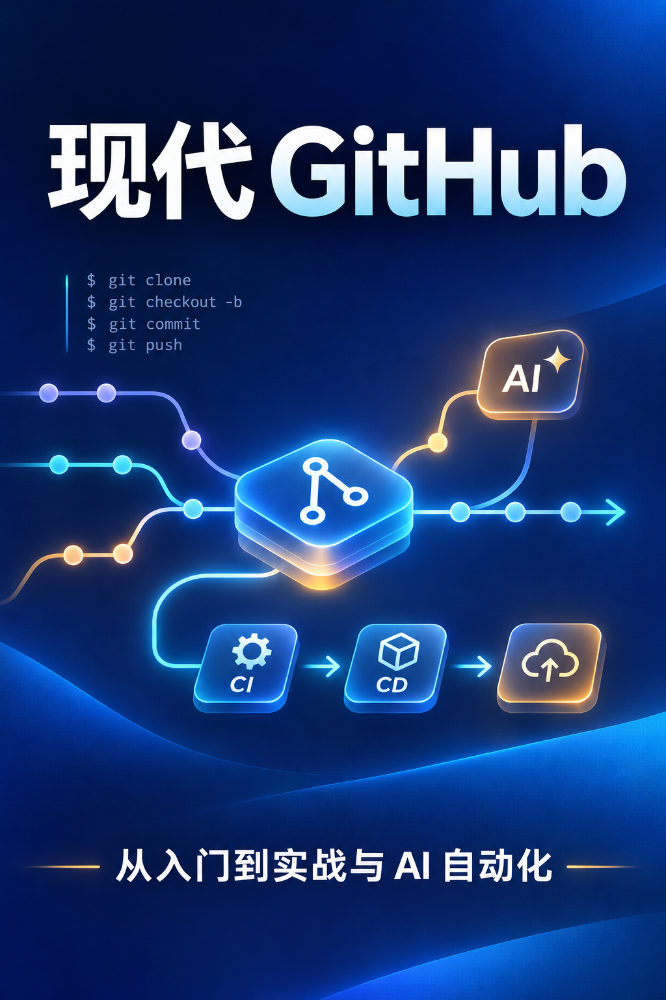

# 现代 GitHub：从入门到实战与 AI 自动化

这是一套面向 Git/GitHub 初学者的实践型书稿。全书以一个 `resource-nav` 学习资源导航项目为主线，从第一次网页贡献开始，逐步学习 Git Bash、分支、Issue、Pull Request、CI、Pages、维护和受约束的 AI 自动化。

普通主线命令统一使用 Git Bash；Self-hosted Runner、GitHub API/App、Webhook、Actions 工程化和第三方 Agent 放在附录中，按实际场景阅读。

## 阅读顺序

从 [导读](<笔记/现代 GitHub：00 导读.md>) 开始，再按章节顺序阅读：

- [现代 GitHub：00 导读](<笔记/现代 GitHub：00 导读.md>)
- [现代 GitHub：01 从一个仓库开始：看懂项目、Issue、提交和 PR](<笔记/现代 GitHub：01 从一个仓库开始：看懂项目、Issue、提交和 PR.md>)
- [现代 GitHub：02 把一次修改带回本地：Git Bash、Git 和 gh](<笔记/现代 GitHub：02 把一次修改带回本地：Git Bash、Git 和 gh.md>)
- [现代 GitHub：03 安全地协作：分支、同步、冲突与恢复](<笔记/现代 GitHub：03 安全地协作：分支、同步、冲突与恢复.md>)
- [现代 GitHub：04 从需求到可执行计划：Issue、子任务和项目视图](<笔记/现代 GitHub：04 从需求到可执行计划：Issue、子任务和项目视图.md>)
- [现代 GitHub：05 让修改经过评审：PR、检查、合并与关闭 Issue](<笔记/现代 GitHub：05 让修改经过评审：PR、检查、合并与关闭 Issue.md>)
- [现代 GitHub：06 从贡献者到维护者：让项目可以被别人继续使用](<笔记/现代 GitHub：06 从贡献者到维护者：让项目可以被别人继续使用.md>)
- [现代 GitHub：07 从资源清单到小程序：第一次读码、改码和测试](<笔记/现代 GitHub：07 从资源清单到小程序：第一次读码、改码和测试.md>)
- [现代 GitHub：08 让每个 PR 接受自动检查：Actions、CI 和合并门禁](<笔记/现代 GitHub：08 让每个 PR 接受自动检查：Actions、CI 和合并门禁.md>)
- [现代 GitHub：09 从构建结果到上线：Pages、产物、Environment 和回滚](<笔记/现代 GitHub：09 从构建结果到上线：Pages、产物、Environment 和回滚.md>)
- [现代 GitHub：10 让已上线项目继续可靠：维护、费用、权限与故障](<笔记/现代 GitHub：10 让已上线项目继续可靠：维护、费用、权限与故障.md>)
- [现代 GitHub：11 把一个有边界的任务交给 Agent：计划、分支、PR 和验收](<笔记/现代 GitHub：11 把一个有边界的任务交给 Agent：计划、分支、PR 和验收.md>)
- [现代 GitHub：12 从手动审阅到受控自动化：事件、评论、停止与证据](<笔记/现代 GitHub：12 从手动审阅到受控自动化：事件、评论、停止与证据.md>)
- [终章：一次完整升级](<笔记/现代 GitHub：终章 一次完整升级.md>)

## 附录

- [现代 GitHub：附录 A Self-hosted Runner](<笔记/现代 GitHub：附录 A Self-hosted Runner.md>)
- [现代 GitHub：附录 B GitHub CLI、API 和 GitHub App](<笔记/现代 GitHub：附录 B GitHub CLI、API 和 GitHub App.md>)
- [现代 GitHub：附录 C Webhook 与事件接收](<笔记/现代 GitHub：附录 C Webhook 与事件接收.md>)
- [现代 GitHub：附录 D Actions 工程化选择](<笔记/现代 GitHub：附录 D Actions 工程化选择.md>)
- [现代 GitHub：附录 E 第三方 Agent 与产品迁移](<笔记/现代 GitHub：附录 E 第三方 Agent 与产品迁移.md>)

## 配套资源

示例代码、测试、workflow、Webhook fixture 和额度截图位于 [`笔记/_assets/modern-github/`](<笔记/_assets/modern-github/>)。书稿正文会明确哪些资源需要复制、哪些只是参考。

正文会区分本地静态检查、本机测试和 GitHub 云端验证；本仓库不把未执行的云端流程写成已验证结果。

## 逐章实测

关键章节已在临时实验仓库实际执行并记录证据：[TEST-REPORT.md](https://github.com/WangKangAandy/modern-github-book-lab/blob/main/TEST-REPORT.md)。报告区分云端通过、部分通过和账号资格阻断；不把未执行的 Copilot Cloud、gh-aw 云端模型或公网 Webhook 写成成功。
